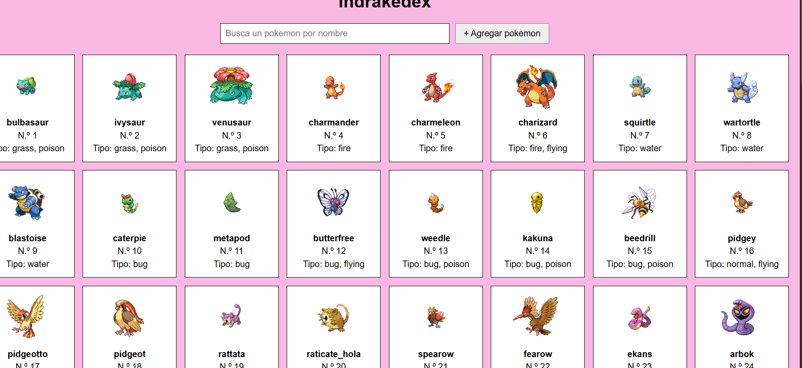

# IndraKedex

Web Pokedex con frontend en HTML/CSS/JS y backend en Node.js + SQLite. Los primeros 100 pokemon se descargan de PokeAPI la primera vez que arranca el servidor y se guardan en una base de datos local (`pokedex.db`). El frontend consume la API propia (listar, buscar, agregar, editar y eliminar).

## Screenshot



## Requisitos

- Node.js 22.5 o mayor (usa el modulo integrado `node:sqlite`, no hay que instalar dependencias)
- Internet la primera vez, para sembrar la base de datos desde PokeAPI

## Run Locally

1. Clona el repositorio:

```bash
git clone https://github.com/your-username/IndraKedex.git
cd IndraKedex
```

2. Inicia el servidor:

```bash
npm start
```

3. Abre en el navegador:

```
http://localhost:3000
```

Para volver a empezar con los datos originales, borra `pokedex.db` y reinicia el servidor.

## API

| Metodo | Ruta               | Descripcion                    | Respuesta |
|--------|--------------------|--------------------------------|-----------|
| GET    | `/api/pokemon`     | Lista todos los pokemon        | 200       |
| GET    | `/api/pokemon/:id` | Obtiene un pokemon             | 200 / 404 |
| POST   | `/api/pokemon`     | Crea un pokemon                | 201 / 400 / 409 |
| PUT    | `/api/pokemon/:id` | Actualiza un pokemon           | 200 / 400 / 404 / 409 |
| DELETE | `/api/pokemon/:id` | Elimina un pokemon             | 200 / 404 |

Cuerpo para POST y PUT (JSON):

```json
{
  "nombre": "pikachu",
  "altura": 0.4,
  "peso": 6,
  "tipos": ["electric"],
  "habilidades": ["static", "lightning-rod"],
  "imagen": "https://..."
}
```

`nombre` es obligatorio y unico; `tipos` y `habilidades` aceptan un arreglo o texto separado por comas.

## Estructura

```
server.js        backend (http + sqlite + seed desde PokeAPI)
public/          frontend (index.html, script.js, styles.css)
pokedex.db       base de datos (se crea sola)
```

## Configuracion opcional

- `PORT`: puerto del servidor (por defecto 3000)
- `POKEAPI_URL`: URL de PokeAPI para el seed (por defecto `offset=0&limit=100`; usa `offset=20` si quieres la misma lista de la tarea original)
